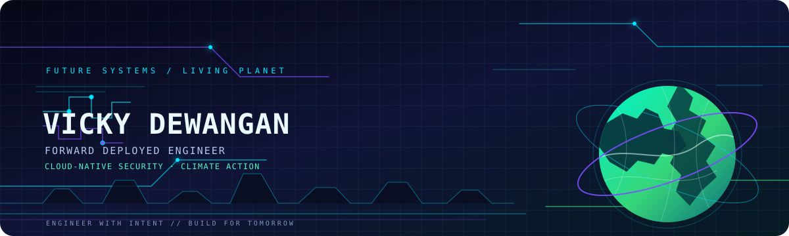

<!--
Vicky Dewangan | GitHub Profile README
Place this file in the root of the repository named exactly: Vickydew1
Keep assets/futuristic-header.svg alongside this README for the custom header background.
GitHub does not allow profile README Markdown to change the entire page background; this banner gives the profile a custom futuristic visual identity.
-->

<div align="center">
  
</div>

<div align="center">


<br/>

<a href="https://linkedin.com/in/vickydewangan"></a>
<a href="https://vicky-portfolio.rf.gd"></a>
<a href="mailto:dewanganvicky135@gmail.com"></a>

<br/><br/>

`FORWARD DEPLOYED ENGINEER @ ACCUKNOX` &nbsp; `CLOUD-NATIVE SECURITY` &nbsp; `CLIMATE ADVOCATE`

</div>

---

## `whoami`

Hey, I'm Vicky — an engineer who likes getting close to real problems, understanding how systems behave, and building solutions that are useful, reliable, and secure.

At **[AccuKnox](https://accuknox.com/)**, I work around cloud-native security, Kubernetes runtime protection, and DevSecOps. Outside engineering, I'm interested in climate action and biodiversity — because building a better future should mean more than shipping better software.

```text
┌──────────────────────────────────────────────────────────────┐
│  CURRENT ROLE   Forward Deployed Engineer @ AccuKnox          │
│  CORE ZONE      Cloud Security · Backend · DevSecOps          │
│  SIDE QUEST     Climate Action · Biodiversity · Climate Tech   │
│  BUILD PHILOSOPHY  Understand → Build → Secure → Improve       │
└──────────────────────────────────────────────────────────────┘
```

## `mission_control/`

<table>
  <tr>
    <td width="50%" valign="top">
      <h3>🔐 Cloud & Security</h3>
      Kubernetes runtime protection, cloud-native security, DevSecOps, and resilient workloads.
    </td>
    <td width="50%" valign="top">
      <h3>⚡ Software Engineering</h3>
      Backend services, APIs, automation, data workflows, and practical product engineering.
    </td>
  </tr>
  <tr>
    <td width="50%" valign="top">
      <h3>🧰 Build toolkit</h3>
      Python, FastAPI, Django, Node.js, React, C++, SQL, Docker, and Kubernetes.
    </td>
    <td width="50%" valign="top">
      <h3>🌍 Planet mode</h3>
      Climate action, biodiversity conservation, and technology for meaningful impact.
    </td>
  </tr>
</table>

## `tech_stack --visual`

<div align="center">

**LANGUAGES & APPLICATIONS**


**CLOUD & DEVELOPER TOOLS**


</div>

> **My kind of engineering:** understand the problem first, build with purpose, and keep security in the design — not as an afterthought.

## `outside_the_terminal/`

Not every meaningful problem can be solved with code. 🌱

I'm interested in the people, communities, and ideas shaping a more sustainable future. My climate and biodiversity interests include involvement with youth-led networks and programs such as:

- 🌿 [Global Youth Biodiversity Network](https://gybn.org/)
- 🌎 [YOUNGO](https://youngoclimate.org/)
- 🤝 [Harvard Project for Asian and International Relations](https://www.hpair.org/)

**The common thread:** solve hard problems, collaborate across perspectives, and think beyond the immediate win.

## `featured_work/`

The best way to understand an engineer is to see what they've built.

🔎 **[Explore all my repositories →](https://github.com/Vickydew1?tab=repositories)**

> **Personalize this section:** pin 2–3 of your strongest repositories on your GitHub profile, then replace this line with direct links and one-sentence descriptions of what you built. Real projects will make this profile much stronger than extra badges.

## `github_telemetry/`

<div align="center">


<br/>


</div>

<sub>Stats are generated by external services and may occasionally be unavailable.</sub>

## `connect --open`

Got an interesting cloud security problem, an engineering idea, an open-source project, or a climate-tech concept? Let's connect.

<div align="center">

<a href="https://linkedin.com/in/vickydewangan"></a>
<a href="mailto:dewanganvicky135@gmail.com"></a>
<a href="https://vicky-portfolio.rf.gd"></a>

<br/><br/>

**STAY CURIOUS. BUILD RESPONSIBLY. LEAVE THINGS BETTER.** 🌍


</div>
